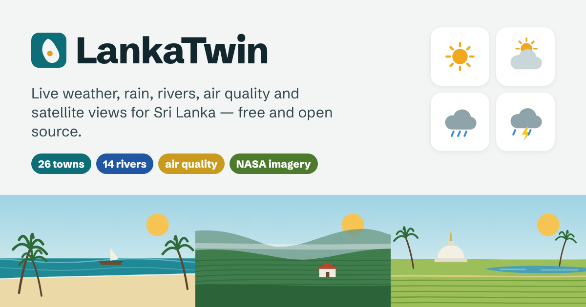

# LankaTwin



**Live at [lankatwin.github.io](https://lankatwin.github.io/)**

**A free, open-source window onto Sri Lanka's weather, rivers, air and land — running entirely in your browser.**

LankaTwin is the public visualisation layer of a climate and resource digital twin for Sri Lanka. It pulls live, open data
straight from the publishers into an interactive map and charts, with no server and no running cost on GitHub Pages.

## What it does

- **Live map** of all 25 district capitals plus Negombo: temperature, feels-like, rain in the last and next 24 h, humidity, gusts, US AQI and PM2.5, colour-coded on the map.
- **Official river gauges** (`#/gauges`): live hourly water levels and rainfall from the Irrigation Department's hydrometric stations (the data behind its [Realtime Water Level in Major River](https://www.arcgis.com/apps/dashboards/2cffe83c9ff5497d97375498bdf3ff38) dashboard): station and alert/minor/major flood counts, basin → station picker, current level with trend, 3-day level chart against the gauge's flood levels, daily rainfall, hourly-update and flood-level lists for the last 4 days, last-hour and 24-hour rainfall rankings, CSV export. Gauges also appear on the main map, raise signals, and feed the live and floods pages; river basins, rivers and mapped flood areas can be shown as map layers.
- **Rivers**: modelled discharge at 14 points on the Kelani, Kalu, Gin, Nilwala, Walawe, Mahaweli, Deduru, Malwathu and other rivers, with a rise indicator comparing the 10-day forecast peak with the past 30 days.
- **Satellite overlays** from NASA GIBS: MODIS true colour (any date), 8-day NDVI, IMERG rain rate, land surface temperature.
- **Place pages**: 24 h / 7 d / 30 d charts for temperature, rain, humidity, wind, air quality and soil moisture; a 7-day forecast; this month's rain against the past decade (ERA5); and solar energy received (NASA POWER).
- **Compare** up to five places on one chart; **signals** for heavy rain, heat stress, strong gusts, poor air and rising rivers.
- **Search** (press `/` or `Ctrl K`) in English, Sinhala or Tamil; **Near me** finds your closest town; **star** places to keep them on top.
- **Images**: a photo of every town from Wikipedia (credited to its Commons author), illustrated landscapes when offline, weather icons, and a daily MODIS satellite image of the whole island.
- **Forecast detail**: next-24-hour strip, 7-day outlook with UV and gusts, the current monsoon season, and the rivers near each town.
- **Share and embed**: share any place, or paste a live `<iframe>` widget into another site (`#/embed/<place>`).
- **Safety**: emergency numbers (117, 119, 110, 1990) and opt-in browser notifications for new warnings while the app is open.
- **Live dashboard** (`#/live`): KPI tiles, a running alert feed (new, escalated and cleared signals with times), town and river boards, a refresh countdown, full screen, keep-screen-on and an optional chime for new warnings. A warning banner and a signal badge in the header show on every page.
- **Phones first**: bottom tab bar (Map, Live, Floods, Signals, More), card layouts in place of wide tables, safe-area padding for notched screens.
- **Floods**: a screening flood-risk score for every town (rain, nearest river, elevation), a flood-risk overlay and the NASA MODIS near-real-time flood-water layer on the map, rivers running high, and before/during/after flood guidance with emergency numbers (117, 119, 110, 1990, 1919).
- **Any spot**: tap anywhere on the map for its elevation (Copernicus 90 m DEM), weather, air quality, modelled river flow and flood risk; the spot is kept in the URL so it can be shared.
- **Air quality page**: US AQI, PM2.5, PM10, ozone, NO₂, dust and UV for every town, with health advice for each AQI band.
- **Three languages**: the whole interface in English, Sinhala and Tamil, including place and river names, weather descriptions, dates and chart axes. See [`docs/TRANSLATIONS.md`](docs/TRANSLATIONS.md) to help review the translations.
- CSV and PNG export, dark mode, mobile layout, offline banner, installable and readable offline (PWA).

> LankaTwin is unofficial. For warnings follow the Department of Meteorology and the Disaster Management Centre (hotline 117).

## Run it

```bash
npm install
npm run dev
npm test          # unit tests
npm run og-image  # redraw public/og-image.png (needs Playwright)
```

## Deploy to GitHub Pages

1. In **Settings → Pages**, set **Source** to **GitHub Actions**.
2. Push to `main`. `.github/workflows/deploy.yml` tests, builds and publishes to `https://lankatwin.github.io/`.

Pull requests run `.github/workflows/ci.yml`: typecheck, unit tests (`npm test`) and a production build.

No base-path configuration is needed: the build uses relative asset paths and hash routing, so it also works on a custom domain.

## Stack

Vite · React 19 · TypeScript · Tailwind CSS 4 · MapLibre GL · Apache ECharts · TanStack Query · Zustand · vite-plugin-pwa

## Data

| Source | Used for |
|---|---|
| [Open-Meteo](https://open-meteo.com) Forecast, Air Quality, Flood, Historical | Weather, CAMS air quality, GloFAS river discharge, ERA5 baseline |
| [NASA POWER](https://power.larc.nasa.gov) | Daily solar irradiance |
| [NASA GIBS](https://nasa-gibs.github.io/gibs-api-docs/) | Satellite overlays |
| [CARTO](https://carto.com/basemaps) / OpenStreetMap | Basemap |
| [Wikipedia](https://en.wikipedia.org) / [Wikimedia Commons](https://commons.wikimedia.org) | Place photos, credited per image |
| [Open-Meteo Elevation](https://open-meteo.com/en/docs/elevation-api) (Copernicus DEM GLO-90) | Elevation of towns and tapped spots |
| [Cloudinary](https://cloudinary.com) | Hosting and on-the-fly optimisation of the landscape scenes and link-preview image, and fetch delivery of town photos (`src/lib/cloudinary.ts`) |

Full licences and attribution are on the in-app **Sources** page. National sources (Meteorology, Irrigation, DMC, data.gov.lk) are
planned through scheduled snapshots — see [`docs/DATA_CONNECTORS.md`](docs/DATA_CONNECTORS.md).

## Docs

- [Architecture](docs/ARCHITECTURE.md)
- [Adding a data connector](docs/DATA_CONNECTORS.md)
- [Translations](docs/TRANSLATIONS.md)
- [Contributing](CONTRIBUTING.md)

## Licence

Code: MIT. Data remains under its publishers' licences (mostly CC BY 4.0 and NASA public domain).
